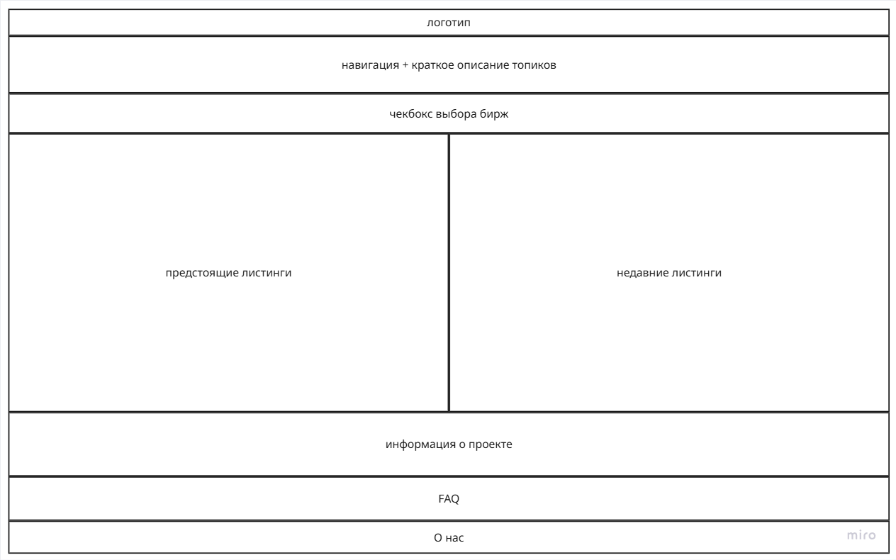
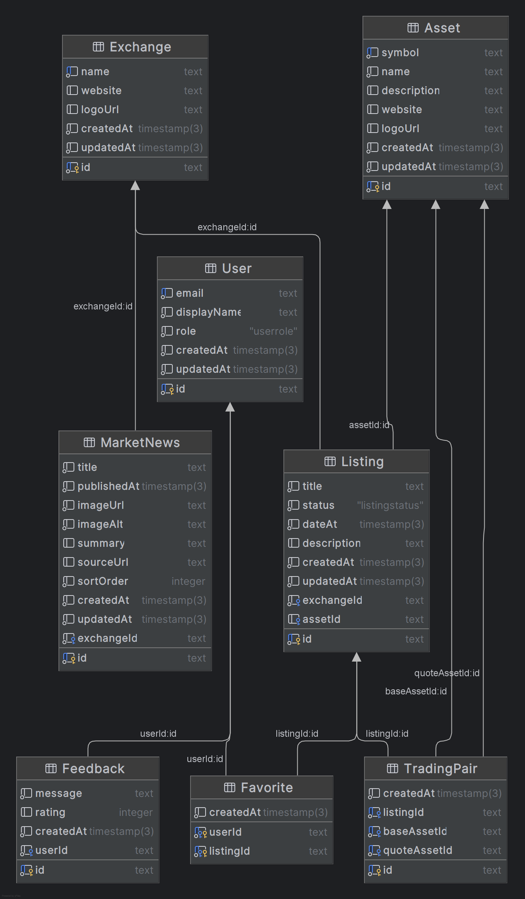

# Crypto Listings Web

Сайт о листингах монет на криптобиржах: выбор биржи, предстоящие и прошедшие листинги (дата, торговые пары, описание),
новости рынка, избранное и отзывы пользователей.

> Курсовой проект по web-программированию, Университет ИТМО (6 семестр).

**Демо:** https://m3307-polyak-6sem.onrender.com



## Возможности

- Серверный рендеринг страниц (Pug) и CRUD для бирж, активов, листингов, новостей и отзывов.
- REST API с документацией Swagger (`/api/docs`) и GraphQL API (Apollo) с ограничением сложности запросов.
- Пагинация (заголовок `Link`), ETag и `Cache-Control` для ответов, кэширование на стороне сервера.
- Регистрация и вход через SuperTokens (сессии в cookie), роли `admin` и `user`.
- Загрузка логотипов в S3-совместимое object storage.
- Избранные листинги пользователя.

## Доменная модель

- `User` — пользователь (email, отображаемое имя, роль).
- `Asset` — криптоактив (тикер, название, описание, сайт, логотип).
- `Exchange` — биржа (название, сайт, логотип).
- `Listing` — событие листинга на бирже (статус, дата, описание), опционально основной актив.
- `TradingPair` — торговая пара листинга (base/quote `Asset`).
- `MarketNews` — новость рынка, привязана к бирже.
- `Feedback` — отзыв пользователя.
- `Favorite` — избранный листинг пользователя.

Связи: `Exchange 1→N Listing`, `Exchange 1→N MarketNews`, `Asset 1→N Listing`, `Asset 1→N TradingPair` (base и quote),
`Listing 1→N TradingPair`, `User 1→N Feedback`, `User N↔N Listing` через `Favorite`.



## Стек

TypeScript, NestJS 11, Prisma 7, PostgreSQL, GraphQL (Apollo Server), REST + Swagger, SuperTokens, Pug, AWS SDK (S3), Jest, ESLint, Prettier.

## Запуск

```bash
npm install
cp .env.example .env          # задать DATABASE_URL, параметры SuperTokens и S3
npx prisma migrate deploy
npm run db:seed               # тестовые данные
npm run start:dev
```

Приложение доступно на http://localhost:4000, Swagger UI находится на `/api/docs`, GraphQL на `/graphql`.

## Структура

```
src/
  assets, exchanges, listings, market-news, feedback   модули предметной области (REST, GraphQL, страницы)
  auth                                                 SuperTokens, guard'ы, роли
  common                                               пагинация, ETag, фильтры ошибок, Swagger-декораторы
  graphql                                              общие типы и плагин сложности запросов
  object-storage                                       загрузка файлов в S3
  prisma                                               PrismaService
prisma/                                                схема, миграции, сид
views/                                                 шаблоны Pug
```
